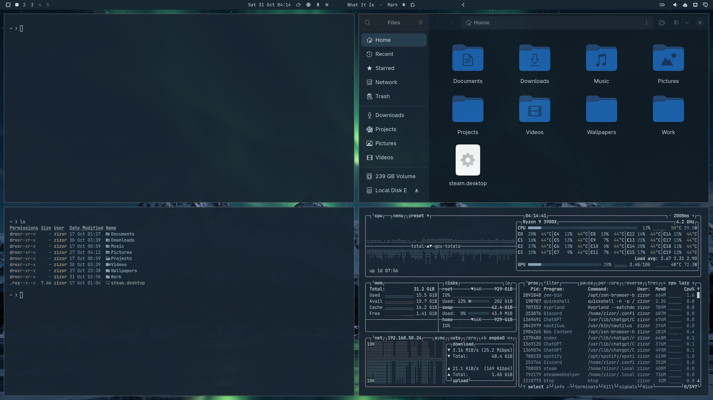
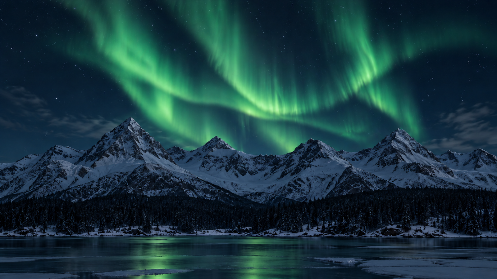

# Nordic Nightfall

A dark Omarchy theme inspired by a Nordic winter night: deep blue-black surfaces, muted cold-blue accents, dark-blue focus borders, and an emerald aurora above snow-shadowed mountains.

**Author:** Z1Z0R  
**Mode:** Dark  
**Tags:** nordic, winter, aurora, blue, dark

## Desktop screenshot



The 4K source capture is included at `submission-assets/nordic-nightfall-4k.png`.

## Wallpaper preview



## Install

After this repository is public on GitHub:

```sh
omarchy theme install https://github.com/Z1Z0R/omarchy-nordic-nightfall-theme.git
```

## Wallpaper credits

Both included wallpapers were generated specifically for this theme with OpenAI Image Generation; no external source photograph was used. Each is 3840 × 2160, upscaled from a 1672 × 941 generated image with Lanczos resampling.

- `backgrounds/001-nordic-winter-shadowed-snow.png` is the darker, cooler night-snow version.
- `backgrounds/002-nordic-winter-aurora-lit-snow.png` has brighter aurora-lit slopes.

Use `omarchy theme bg next` to cycle between the backgrounds after installing the theme.

The palette and included generated wallpaper are provided under the MIT License in this repository.
