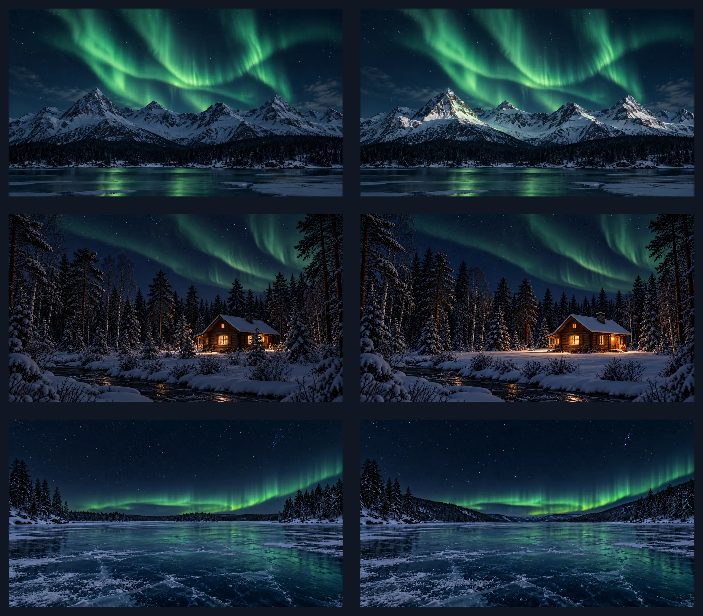

# Nordic Nightfall

A dark Omarchy theme inspired by a Nordic winter night: deep blue-black surfaces, muted cold-blue accents, dark-blue focus borders, and an emerald Aurora Borealis above snow-shadowed mountains. Two forest wallpapers feature fir, pine, and birch around a warm-lit cabin beside a flowing river and beneath a green Aurora Borealis. One is slightly darker, with trees around the log cabin; the other has a snowy clearing softly lit by the cabin. Two frozen-lake wallpapers show the same detailed, gently sweeping green aurora above a broad snow-lined lake: one has a low, tree-lined horizon, while the other places the lake in a valley framed by wooded hills.

**Author:** Z1Z0R  
**Repository:** [https://github.com/Z1Z0R/Nordic-Nightfall](https://github.com/Z1Z0R/Nordic-Nightfall)  
**Mode:** Dark  
**Tags:** nordic, winter, aurora, blue, dark

## Desktop screenshot


The 4K source capture is included at `submission-assets/nordic-nightfall-4k.png`.

## Install

Install from GitHub:

```sh
omarchy theme install https://github.com/Z1Z0R/Nordic-Nightfall.git
```

The theme uses a custom, darker blue variant of the Yaru folder icons and applies
its GTK colors only while Nordic Nightfall is active. Install the appearance
hook, then apply the theme:

```sh
omarchy hook install theme-set ~/.config/omarchy/themes/nordic-nightfall/hooks/50-nordic-nightfall-appearance
omarchy theme set nordic-nightfall
```

The hook installs the icon overlay and applies Files-only GTK styles when this
theme is selected, then restores the GTK stylesheets that were in place before
installation when you switch to another theme. Close and reopen Files after
switching themes so it reloads the active GTK styles.

## Wallpapers



## Wallpaper credits

All six included wallpapers were generated specifically for this theme with OpenAI Image Generation; no external source photograph was used. Each is 3840 × 2160, upscaled from a 1672 × 941 generated image with Lanczos resampling.

- `backgrounds/001-nordic-winter-shadowed-snow.png` is the darker, cooler night-snow version.
- `backgrounds/002-nordic-winter-aurora-lit-snow.png` has brighter aurora-lit slopes.
- `backgrounds/003-nordic-forest-cabin.png` is the slightly darker version, with fir, pine, and birch trees around the log cabin beside the flowing river and green aurora.
- `backgrounds/004-nordic-forest-cabin-clearing.png` shows a snowy clearing around the cabin, with fir, pine, and birch trees, the same flowing river and green aurora, and snow softly lit by the cabin’s lighting.
- `backgrounds/005-nordic-frozen-lake-aurora.png` shows a broad frozen lake beneath the detailed, low green aurora, with a mostly level, tree-lined horizon and a soft reflection across the ice.
- `backgrounds/006-nordic-frozen-lake-valley.png` shows the same aurora above a frozen lake between wooded hills that form a valley, with the aurora visible in the open sky above the distant hills.

Use `omarchy theme bg next` to cycle between the backgrounds after installing the theme.

The palette and included generated wallpapers are provided under the MIT License
in this repository. The adapted Yaru folder icons retain their CC BY-SA 4.0
license; see [THIRD-PARTY-NOTICES.md](THIRD-PARTY-NOTICES.md).

